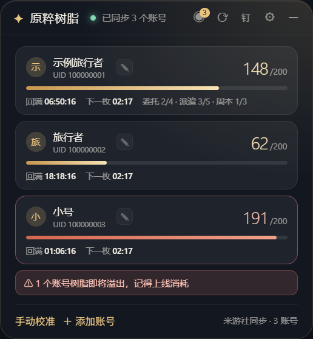
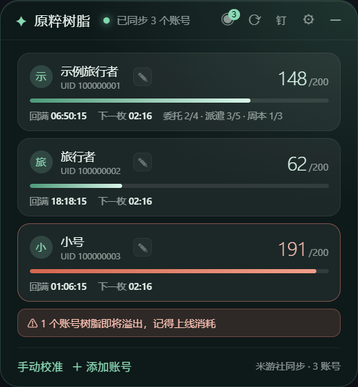
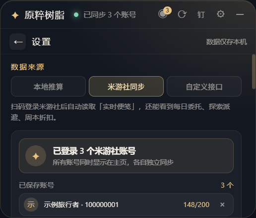
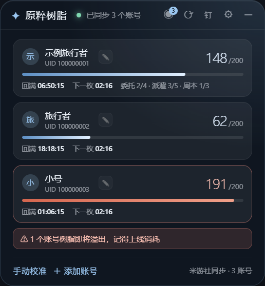
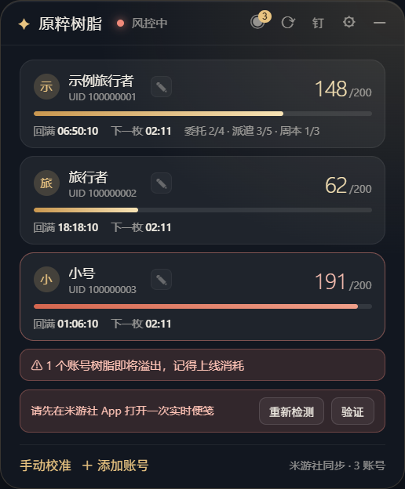

# 原粹树脂 · 桌面小组件

一个常驻 Windows 桌面的《原神》树脂小组件：实时显示当前树脂、回满倒计时，支持多账号并列、桌面钉住、多套配色。

> 非官方工具。只读取你自己的账号数据，不做任何写操作，代码全部开源可自行审计。



## 功能

- **实时树脂与倒计时**：显示当前树脂（上限 200）、回满时刻、下一枚恢复倒计时，每 8 分钟 1 点本地推算
- **多账号并列**：多个米游社账号同时显示在主界面，各自独立刷新，某个账号异常不影响其它账号
- **米游社扫码登录**：模拟米游社 App 扫码流程，Cookie 用 Electron `safeStorage`（DPAPI）加密后落盘
- **便笺 API 同步**：调用米游社官方游戏便笺接口读取真实树脂，带 DS2 签名、设备指纹与人机验证链路
- **桌面钉住**：把窗口挂到桌面层（壁纸与图标之上、普通窗口之下），开机即见，不挡工作区
- **六套配色**：金曜 / 晨霜 / 翠玉 / 樱绯 / 紫晶 / 石墨，随主题切换整套变量
- **手动校准**：独立校准浮层，多账号可逐个校准；快捷数值 0/20/40/80/120/160/满
- **托盘常驻**：托盘图标可唤出、切换界面、立即同步；支持开机自启与界面缩放

## 截图

| 双主题 | 设置页 |
| --- | --- |
|  |  |

| 晨霜 | 风控态 |
| --- | --- |
|  |  |

## 安装

从 [Releases](../../releases) 下载任一：

- `ResinWidget-Setup-x.y.z.exe`：安装版，可选安装目录，生成桌面与开始菜单快捷方式
- `ResinWidget-Portable-x.y.z.exe`：便携版，单文件免安装

Windows 10/11 x64。首次运行若弹出 SmartScreen 提示，点「更多信息 → 仍要运行」（未做代码签名）。

## 使用

1. 托盘菜单或主界面「账号」→「扫码登录」，用米游社 App 扫码
2. 登录成功后自动同步一次，之后按设定间隔（默认 5 分钟，最低 3 分钟）刷新
3. 需要常驻桌面时打开「固定在桌面」：窗口会贴在桌面层，点托盘图标可临时唤出
4. 想换配色：设置页 → 配色，六套主题即时生效

## 关于风控（重要）

米游社对便笺接口有两层限制，返回码不同，处置方式也不同。

**`1034`（账号级人机验证）**

- 请到**米游社 App** 内打开一次「我的角色 → 实时便笺」，或等冷却结束（组件默认冷却 30 分钟）
- 期间可先用「手动校准」按 App 显示的树脂填一次，本地会按 8 分钟 1 点继续推算

**`5003`（设备校验层拒绝）**

- 这个错误在 DS 签名校验**之前**返回：故意写错 DS、完全不带 DS，得到的都是同一个 5003
- 实测换 UA、client_type、device_fp、device_id 格式、浏览器会话、补 `x-rpc-app_id` 等 7 组组合，全部 5003
- 但同一份 Cookie 调 `getUserGameRolesByCookie` 仍返回 0 —— 说明**登录态有效，被挡的只是战绩类接口**
- 结论：这一层无法从客户端绕过。界面会直接提示「米游社限制读取」，并只保留一次重试后停手（连续撞门会加深风控标记）
- 此时请用「手动校准」填一次当前树脂，之后按 8 分钟 1 点本地推算，倒计时与溢出提醒依然准确
- 若怀疑是家宽 IP 被限，可切手机热点后点「重新检测」对比一次

## 开发

```bash
npm install
npm start              # 开发模式运行
npm run check          # 全部 JS 语法检查
npm run selftest:app   # 界面与 IPC 自检
npm run selftest:store # 存档与迁移自检
npm run preview        # 生成界面预览图
```

### 打包

```bash
npm run icon         # 由 SVG 渲染 build/icon.png（512×512）
npm run dist         # NSIS 安装包 → release/
npm run dist:portable# 便携版     → release/
npm run dist:dir     # 只解包，不生成安装器（调试用）
```

打包使用 [electron-builder](https://www.electron.build/)。国内网络建议先设置镜像：

```bash
set ELECTRON_MIRROR=https://npmmirror.com/mirrors/electron/
set ELECTRON_BUILDER_BINARIES_MIRROR=https://npmmirror.com/mirrors/electron-builder-binaries/
```

## 结构

```
src/main.js        主进程：窗口 / 托盘 / IPC / 同步调度 / 层级 / 验证窗口
src/store.js       存档：多账号模型、加密、界面配置
src/api.js         米游社接口：DS2 签名、便笺、设备指纹、人机验证
src/qrlogin.js     扫码登录
src/devicefp.js    设备指纹生成
src/renderer.js    渲染层：卡片列表、设置、校准浮层、拖动
src/styles.css     主题变量与全部样式
assets/deskpin.ps1 桌面钉住（user32 P/Invoke，SetParent 到 Progman）
assets/gt.0.4.9.js 极验 v3（本地内置副本，验证页从本机 http 提供）
```

## 说明

- 存档位置：`%APPDATA%\genshin-resin-widget\widget-config.json`，Cookie 字段为 DPAPI 密文
- 卸载不会删除存档；需要彻底清理请手动删除该目录
- 本项目与米哈游 / HoYoverse 无任何关联，仅供个人学习与自用

## License

MIT
